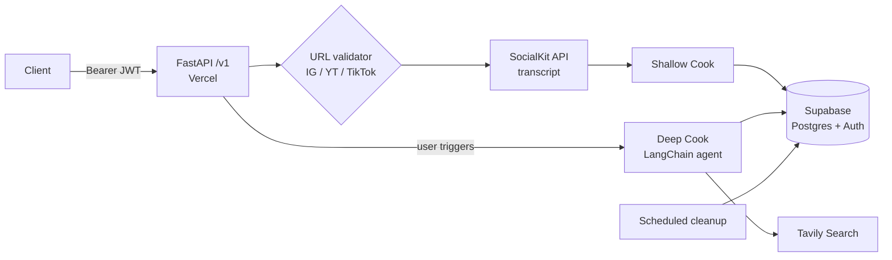

<div align="center">

# ReelVault AI

**Turn short-form videos into verified, actionable, searchable knowledge.**

[](https://www.python.org/)
[](https://fastapi.tiangolo.com/)
[](https://www.langchain.com/)
[](https://supabase.com/)
[](https://reel-vault-7r89.vercel.app)


[Live API](https://reelvault-beta.vercel.app/) · [Architecture](#architecture) · [Quick start](#quick-start) · [API](#api) · [Roadmap](#roadmap)

</div>

---

## Overview

Short videos are where people discover scholarships, internships, hackathons and government schemes, and also where scams and misinformation spread. ReelVault takes a shared Reel, Short or TikTok, extracts what is said, checks it, and saves the result in a personal vault with deadlines you can act on.

Two processing modes:

| Mode | Trigger | What it does | Cost / latency |
|---|---|---|---|
| **Shallow Cook** | Automatic on every submitted URL | Fetches the video transcript and runs a quick first-pass check | Low / seconds |
| **Deep Cook** | User-triggered on one opportunity | Agentic web research (Tavily search tools via LangChain) to verify the offer against official sources | Higher / tens of seconds |

Opportunities are removed automatically after their deadline plus a configurable grace period.

## Features

- **URL ingestion** for Instagram, YouTube and TikTok links (other domains are rejected)
- **Transcript extraction** via the SocialKit API
- **Shallow Cook:** quick automatic check, returns the transcript and first-pass result
- **Deep Cook:** tool-calling agent that searches the web and cites sources
- **Personal vault:** past transcripts and results stored per user in Supabase
- **Auth:** Supabase login and logout; every record is scoped to its user
- **Deadline-aware cleanup:** expired opportunities pruned after `deadline + RETENTION_GRACE_DAYS`

## Architecture



**Stack**

| Layer | Choice |
|---|---|
| API | Python, FastAPI (routes under `/v1`) |
| LLM orchestration | LangChain (verification chains, tool calling) |
| Ingestion | SocialKit API (Instagram/YouTube/TikTok transcripts) |
| Web research | Tavily Search |
| Database + Auth | Supabase (Postgres, Row Level Security) |
| Hosting | Vercel |
| Dependencies | `server/pyproject.toml` |

## Quick start

### Prerequisites

- Python 3.11+
- A [Supabase](https://supabase.com/) project
- API keys: SocialKit, Tavily, and your LLM provider

### Run locally

```bash
git clone https://github.com/<your-username>/reelvault-ai.git
cd reelvault-ai/server

python -m venv .venv
source .venv/bin/activate        # Windows: .venv\Scripts\activate
pip install -e .                 # installs from pyproject.toml

cp .env.example .env             # then fill in the values below
uvicorn app.main:app --reload --port 8000
```

Interactive docs: <http://localhost:8000/docs>

> Adjust `app.main:app` if your entry module differs.

### Environment variables

| Variable | Description |
|---|---|
| `SUPABASE_URL` | Supabase project URL |
| `SUPABASE_ANON_KEY` | Public key, used with the user's JWT |
| `SUPABASE_SERVICE_ROLE_KEY` | Server-only; never expose to clients |
| `SOCIALKIT_API_KEY` | Transcript provider key |
| `TAVILY_API_KEY` | Web search for Deep Cook |
| `LLM_API_KEY` | Key for the model used by LangChain |
| `RETENTION_GRACE_DAYS` | Days to keep an opportunity after its deadline |

Never commit `.env`. On Vercel, set these under **Project Settings, Environment Variables**.
## Data model (sketch)

| Table | Key columns |
|---|---|
| `reels` | `id`, `user_id`, `url`, `platform`, `created_at` |
| `transcripts` | `reel_id`, `text`, `language`, `source` |
| `results` | `reel_id`, `mode` (`shallow` / `deep`), `payload` (JSON), `sources`, `created_at` |
| `opportunities` | `id`, `reel_id`, `title`, `deadline`, `official_url`, `expires_at` |

Enable **Row Level Security** on every table with a `user_id = auth.uid()` policy. Store links and derived data (transcript, results), not copies of the video files.

## Deployment

The backend runs on Vercel at <https://reel-vault-7r89.vercel.app>.

```bash
npm i -g vercel
vercel link
vercel env pull .env.local     # sync env vars
vercel --prod
```

Local prototype and the deployed backend share the same `/v1` routes, so a client only needs to switch `BASE_URL`.


## Project structure

```text
reelvault-ai/
├── server/
│   ├── pyproject.toml      # dependencies
│   ├── app/                # FastAPI app, routers under /v1
│   └── .env.example
└── README.md
```

## Contributing

1. Fork the repo and create a branch: `git checkout -b feat/your-change`
2. Keep changes small and tested
3. Open a pull request describing the behavior change
4. New Changes or ideas are always welcomed
